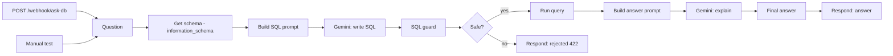

# Postgres SQL Agent (n8n)

Ask your PostgreSQL database a question in plain language and get the SQL, the rows and a short answer.
The model writes the query from your **live schema**, and a **read-only guard** checks it before anything touches the database.



## Two layers of safety

1. **Use a read-only database user** for the Postgres credential (this is the real protection):
   ```sql
   CREATE ROLE n8n_readonly LOGIN PASSWORD '<choose one>';
   GRANT CONNECT ON DATABASE yourdb TO n8n_readonly;
   GRANT USAGE ON SCHEMA public TO n8n_readonly;
   GRANT SELECT ON ALL TABLES IN SCHEMA public TO n8n_readonly;
   ```
2. **SQL guard** (Code node) rejects anything that isn't a single `SELECT` / `WITH … SELECT`: multiple statements, `INSERT/UPDATE/DELETE/DROP/ALTER/TRUNCATE/COPY/GRANT…`, data-modifying CTEs, `pg_sleep`, `dblink` and similar. Keywords inside string literals are ignored, and every query gets `LIMIT 100` at most.

Rejected questions return HTTP 422 with the reason.

## Setup

1. Credentials: **Postgres** (with the read-only user above) and **Google Gemini (PaLM) API** ([get a key](https://aistudio.google.com/apikey)).
2. **Workflows → Import from file** → [`Postgres_SQL_Agent.json`](Postgres_SQL_Agent.json) and select both credentials.
3. The schema query reads the `public` schema; change it in *Get Schema* if your tables live elsewhere.
4. **Test workflow** (demo question), then activate.

## Usage

```bash
curl -X POST https://<your-n8n>/webhook/ask-db \
  -H "Content-Type: application/json" \
  -d '{"question": "Which 5 customers spent the most in the last 90 days?"}'
```

Response:

```json
{ "ok": true, "question": "...", "sql": "SELECT ... LIMIT 5", "rowCount": 3, "rows": [ ... ], "answer": "..." }
```

## Development

[`generate_workflow.py`](generate_workflow.py) builds the JSON; `python test_workflow.py` runs 10 tests: structure, no secrets, and the guard against writes, stacked statements, data-modifying CTEs, `pg_sleep`, comment tricks and over-large limits (executed in Node.js).

## Costs and limits

- Two Gemini 2.5 Flash calls per question (a fraction of a cent).
- The model sees table and column names and types, never your data, until the query runs; the answer step sees at most 50 result rows.
- Large schemas are cut at 600 columns; point the schema query at the tables that matter.
- Always read the returned SQL before trusting a number.

## Status

Verified on 2026-10-27 on a self-hosted n8n with real Gemini calls and a sample two-table schema (the database nodes used sample data, as no Postgres server was attached): the generated SQL was a correct join with a 90-day filter, it passed the guard, and the answer matched the rows; 10 local tests passing.

## License

MIT, see [LICENSE](LICENSE). Built by [CyberResonance](https://cyberresonance.io).
